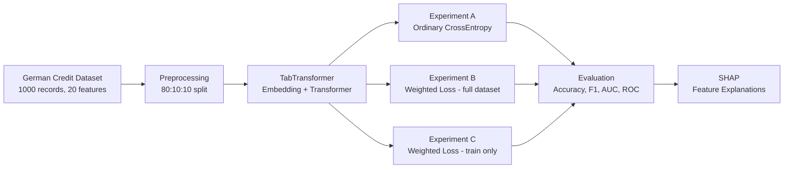

# Credit Risk Predictor — Project Understanding

## What This Project Is

A **research replication project**. The goal is to reproduce the experiments from the paper:

> *"A Novel Weighted Loss TabTransformer Integrating Explainable AI for Imbalanced Credit Risk Datasets"*

This is **not** just a loan-prediction demo — it's an academic paper replication with rigorous methodology.

---

## The Core Idea

The paper proposes using a **TabTransformer** (a Transformer-based model for tabular data) with a **class-weighted loss function** to handle the class imbalance in credit risk datasets. The central claim is that weighted loss improves accuracy on imbalanced data.



---

## Datasets

### 1. German Credit Dataset (Primary — Start Here)
| Property | Value |
|----------|-------|
| Source | UCI Statlog German Credit Data |
| Records | 1,000 |
| Features | 20 (7 numerical, 13 categorical) |
| Target | Binary: 0 = Bad credit, 1 = Good credit |
| Class distribution | 300 bad (30%), 700 good (70%) |
| File | `dataset/german.data` |

**Key features**: Checking account status, Duration, Credit history, Purpose, Credit amount, Savings account, Employment, Installment rate, Personal status & sex, Other debtors, Residence duration, Property, Age, Other installment plans, Housing, Existing credits, Job, Dependents, Telephone, Foreign worker

**Important business constraint**: Misclassifying a bad customer as good costs **5× more** than the reverse.

### 2. BISAID Dataset (Secondary — After German Credit works)
| Property | Value |
|----------|-------|
| Records | 2,563 |
| Features | 12 original (5 identity fields removed) |
| Target | **4-class** classification |
| Class counts | 379, 1146, 539, 499 |

> [!IMPORTANT]
> Do NOT start BISAID until German Credit is fully working end-to-end. The class semantics for BISAID are unclear from the paper — verify before proceeding.

---

## Model: TabTransformer

Uses the [lucidrains/tab-transformer-pytorch](https://github.com/lucidrains/tab-transformer-pytorch) implementation.

| Hyperparameter | German Credit | BISAID |
|---------------|---------------|--------|
| Embedding dimension | 64 | 128 |
| Transformer depth | 2 | 1 |
| Attention heads | 2 | 2 |
| Attention dropout | 0.1 | 0.1 |
| FF dropout | 0.1 | 0.1 |
| Output classes | 2 | 4 |
| Batch size | 64 | 64 |

**Optimizer**: AdamW, lr=0.001, up to 100 epochs (author implementation choice — not paper-confirmed)

---

## Project Structure (Target Layout)

```
credit-risk-replication/
├── data/
│   ├── raw/
│   └── processed/
├── notebooks/
│   ├── 01_data_audit.ipynb
│   ├── 02_preprocessing.ipynb
│   ├── 03_baseline.ipynb
│   ├── 04_weighted_loss.ipynb
│   └── 05_shap_analysis.ipynb
├── src/
│   ├── data.py
│   ├── preprocessing.py
│   ├── model.py
│   ├── train.py
│   ├── losses.py          ← weighted loss function
│   ├── evaluate.py
│   └── explain.py         ← SHAP explanations
├── configs/
│   ├── german_credit.yaml
│   └── bisaid.yaml
├── outputs/
│   ├── metrics/results.csv
│   ├── plots/             ← confusion matrices, ROC, loss curves, SHAP
│   └── models/            ← checkpoints
├── requirements.txt
└── README.md
```

---

## Implementation Phases

### Phase 0 — Environment Setup
- Create virtual env (`.venv`)
- Install: `torch pandas numpy scikit-learn matplotlib seaborn shap ucimlrepo tab-transformer-pytorch`

### Phase 1 — Data Audit (`01_data_audit.ipynb`)
- Load via `ucimlrepo` (id=144)
- Map labels: UCI `{1→Good, 2→Bad}` → Paper `{1→1, 2→0}` (good=1, bad=0)
- Verify: 1000 records, 300 bad / 700 good, no missing values
- Output: `outputs/data_audit.json`

### Phase 2 — Split & Preprocessing (`02_preprocessing.ipynb`)
- **80:10:10** stratified split (800 train / 100 val / 100 test)
- Categorical features → integer IDs for embeddings
- Numerical features → `MinMaxScaler(feature_range=(-1, 1))` fit on train only
- Handle missing values with imputer fit on train only
- Reserve unknown-category ID for unseen categories

> [!WARNING]
> The paper mentions one-hot encoding, but TabTransformer uses categorical embeddings. This methodological ambiguity must be documented — do NOT silently pretend it's an exact match.

### Phase 3 — Build TabTransformer (`src/model.py`)
- Use `lucidrains/tab-transformer-pytorch`
- Instantiate with German Credit hyperparameters from Table 4

### Phase 4 — Train Unweighted Baseline (`src/train.py`)
- Standard PyTorch training loop
- Seed everything (SEED=42) for reproducibility
- Save best validation checkpoint
- Also train logistic regression as sanity-check

### Phase 5 — Weighted Loss (`src/losses.py`)
Three experiments:

| Experiment | Loss | Purpose |
|-----------|------|---------|
| A | Ordinary cross-entropy | Baseline |
| B | Weighted loss (full dataset class counts) | Paper's reported procedure |
| C | Weighted loss (train labels only) | Leakage-conscious comparison |

Weight formula: $w_i = \frac{N}{N_i}$ where $N$ = total samples, $N_i$ = samples in class $i$

### Phase 6 — Evaluation (`src/evaluate.py`)
Metrics for every model:
- Accuracy, Precision, Recall, F1 per class
- Macro-F1, Macro-Recall
- **F2 score** (paper discusses this)
- Confusion matrix
- ROC curve + AUC (one-vs-rest for 4-class)

**Reference targets from paper:**
| Dataset | Unweighted | Weighted |
|---------|-----------|---------|
| German Credit | 93% | 95% |
| BISAID | 86.35% | 89.27% |

> [!NOTE]
> Exact match is not expected due to methodological ambiguities, random initialization, and split choices. Use validation data for hyperparameter decisions — never the test set.

Also: 10-fold cross-validation for hyperparameter tuning (using only training data, stratified folds).

### Phase 7 — SHAP Explanations (`src/explain.py`)
- Prediction wrapper that applies saved preprocessing internally
- Returns class probabilities
- Small background sample from training data
- Model-agnostic SHAP explainer
- Mean absolute SHAP importance per original feature
- Global feature importance plots + individual prediction explanations

**Expected top features from paper:**
| Dataset | Key Features |
|---------|-------------|
| German Credit | Credit amount, Age, Existing credit status |
| BISAID | Financing needs, Annual sales, Total assets |

### Phase 8 — BISAID (only after Phase 7 complete)
Reuse same pipeline with BISAID config. Verify data and 4-class labels first.

### Phase 9 — Package Results
All outputs saved with reproducibility in mind. `REPRODUCIBILITY_NOTES.md` documenting all discrepancies.

---

## Execution Checklist

- `[ ]` Create repo and Python environment
- `[ ]` Install dependencies
- `[ ]` Load and audit German Credit (verify 1000 records, feature types, target mapping)
- `[ ]` Implement 80:10:10 split and preprocessing
- `[ ]` Build and train unweighted TabTransformer
- `[ ]` Train weighted version
- `[ ]` Generate evaluation tables and ROC curves
- `[ ]` Generate SHAP explanations
- `[ ]` Verify BISAID data and labels
- `[ ]` Document discrepancies and reproduce final run

> [!TIP]
> **Start with only Phases 0-2** (environment + data audit + preprocessing). Don't build a dashboard, tune many models, or touch BISAID until the first unweighted TabTransformer trains successfully.

---

## Key Technical Decisions & Ambiguities to Document

1. **Preprocessing**: Paper says one-hot encoding, but TabTransformer uses embeddings — used embeddings
2. **Optimizer settings** (lr, epochs) not fully specified — used AdamW lr=0.001, 100 epochs
3. **Experiment B vs C**: Whether class weights are computed from full dataset or training-only affects potential label leakage
4. **Random seed**: SEED=42 used throughout for reproducibility
